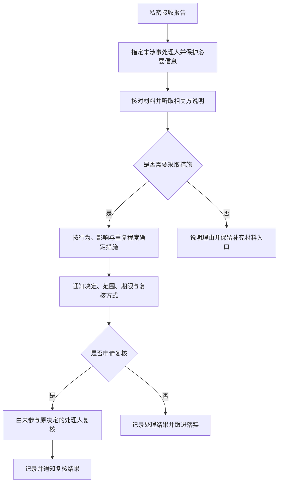

## CODE_OF_CONDUCT · 贡献者行为准则

> 更新：2026-11-06。本准则适用于所有参与者，包括维护者、贡献者、测试人员、报告者和讨论者。目标是让意见分歧可以围绕事实解决，让参与者能够受到尊重地协作。

### 1 适用范围

适用于本项目的代码、文档、Issue、PR、评审、项目会议及项目讨论渠道，也适用于明确代表本项目进行的公开交流。与项目无关的私人活动不因本准则自动纳入管理。

### 2 应遵守的行为

- 针对代码、设计和证据表达意见，说明问题与可执行建议，避免对人的能力或动机下结论。
- 尊重不同背景、身份、性别、民族、宗教、年龄、能力与经验的参与者，为新成员提供必要上下文。
- 接受有依据的纠正，承认错误并修正；无法达成一致时记录决策、理由和剩余分歧。
- 如实标明代码、数据、图片、模型和 AI 辅助产物的来源，不伪造测试结果、性能收益、贡献记录或验收状态。
- 尊重他人的时间、隐私与贡献；评审指出具体问题，维护者对接受或拒绝变更给出可理解的理由。

### 3 不被接受的行为

- 侮辱、威胁、歧视、仇恨表达、性骚扰或不受欢迎的性暗示。
- 持续针对个人攻击、恶意羞辱、围攻、骚扰，或在被要求停止后继续不受欢迎的联系。
- 未经同意公开他人的身份、联系方式、位置、私密对话、账号或其他敏感信息。
- 恶意泄露凭据、滥用权限、故意破坏代码或数据，或以安全报告为名访问未经授权的系统。
- 对提出问题、举报或配合调查的参与者施加报复；明知不实仍捏造指控。善意报告未被证实本身不构成违规。

技术批评、不同意见或拒绝合并变更本身不构成违规；处置应依据具体行为、影响与证据。

### 4 如何报告行为问题

通过与项目维护者已有的私密联系渠道报告，提供发生时间、项目场景、相关链接或消息、具体行为、必要证据和期望的联络方式。只分享必要信息，先对第三方隐私脱敏，不要求报告者公开身份或在公开讨论中自证。

当前仓库未公布专用行为举报邮箱。没有私密渠道时，可在[仓库 Issue](https://github.com/Ivanluv555/ThisWay/issues) 中仅请求安排私密联络，不公布当事人身份、私聊截图或指控细节。

报告涉及维护者时，由未涉事的维护者处理；如暂无独立处理人，应先安排无利益冲突的协助审阅者，并限制材料访问，不能让被举报者独自裁定。漏洞、凭据或数据泄露另按 [14 SECURITY](./SECURITY.md) 处理，必要时与行为问题并行处理。

### 5 处理流程与措施

必要时可先隐藏泄露内容、限制接触或暂停访问，以防影响继续扩大；临时保护措施不等于已经认定违规。材料只在处理所需范围共享，不承诺绝对保密。

| 措施 | 使用情形与要求 |
| --- | --- |
| 提醒与纠正 | 对可纠正的不当表达，指出具体行为与期望改变，必要时要求修改内容 |
| 正式警告 | 对较严重或重复行为，说明后果及后续限制条件 |
| 临时限制 | 限制讨论、评审、合并或其他项目访问，明确范围、期限与恢复条件 |
| 永久移除 | 对严重伤害或持续违规，可撤销项目参与资格及相关权限，并说明依据 |

措施可按严重性直接采用，不要求逐级执行。维护者应及时通知相关方必要结论，不在公共记录中扩散无关身份或证据；项目不承诺尚未建立的固定处理时限。

### 6 复核与责任

相关方可通过原私密渠道提出复核，指出事实错误、程序问题或新增证据。复核由未参与原决定且无利益冲突的人处理；暂无合适人选时应说明安排，不将无法立即安排复核视为申诉放弃。

维护者同样受本准则约束，负责一致执行、保存必要记录并落实权限变更。开发流程遵循 [07 开发规范](./docs/07-开发规范.md)；本准则不能代替代码审查、安全处理或已确认的产品需求。
