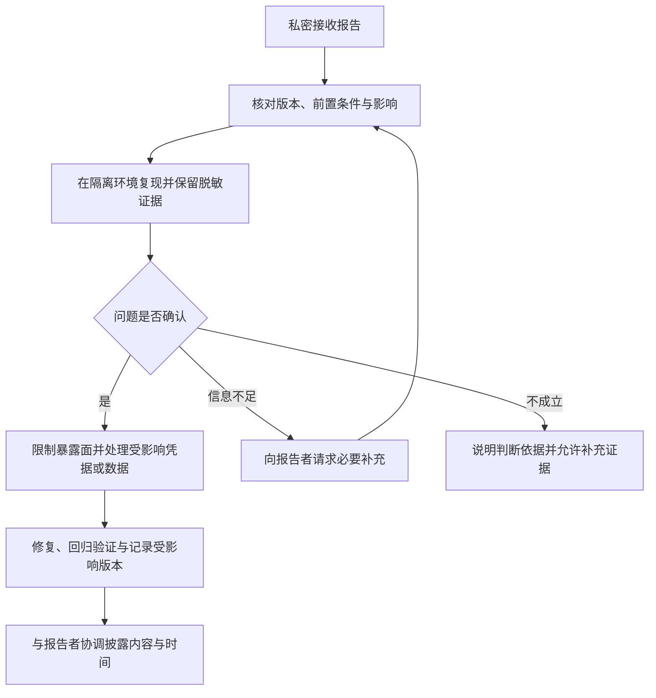

## SECURITY · 安全政策

> 更新：2026-11-06。适用于此地 CIDI 的小程序、Spring Boot、FastAPI、独立原型、数据库脚本及文档。安全要求是贡献和发布的约束，不表示现有实现已满足要求。当前缺口以 [08 项目状态](./docs/08-项目状态与待办.md) 为准。

### 1 支持与维护范围

| 对象 | 处理方式 |
| --- | --- |
| 当前默认分支的代码与配置 | 优先核查报告，在当前开发版本修复并记录验证结果 |
| 已发布版本、旧分支、个人部署 | 报告时提供准确版本；目前没有已公布的长期支持或安全回补版本矩阵，不承诺逐版本回补 |
| Flask、Express 和旧算法原型 | 可报告风险，但不视为已加固的生产服务；是否修复或停用由维护者说明 |
| 微信、旅游平台及其他第三方 | 本项目只处理自身集成问题，不授权对第三方系统开展测试 |

报告以提交 SHA 或发布标识定位，不仅写“最新版”。仓库尚未公布固定响应时限、漏洞奖励计划或安全认证。

### 2 如何报告漏洞

1. 先查看[仓库 Security 页面](https://github.com/Ivanluv555/ThisWay/security)。若提供 **Report a vulnerability**，使用该私密入口；本文不假定它已经启用。
2. 若入口不可用，通过与仓库维护者已有的私密渠道请求接收报告。仓库当前没有公布可验证的专用安全邮箱，不使用猜测的地址。
3. 没有私密渠道时，可在[仓库 Issue](https://github.com/Ivanluv555/ThisWay/issues) 中仅请求维护者提供私密报告方式；不要公开漏洞类型、受影响端点、复现代码、凭据或个人数据。取得私密渠道后再提交详情。

报告至少包含：受影响模块与版本、前置权限、可重复步骤、预期/实际结果、可能影响、脱敏证据及可用的回复方式。PoC 使用自有账号、合成数据和隔离环境，说明哪些影响已经验证、哪些只是推断。

发现疑似有效凭据时只报告文件位置和凭据类别，不在报告正文、截图或后续提交中再次复制其值。不要使用该凭据验证远程数据库或第三方账号。

### 3 核查与披露流程

维护者指定处理人、判断影响并向报告者反馈；修复者记录提交、验证环境和结果。公开披露前先评估补丁、部署与凭据处置，避免把未修复利用细节提前放入公开 PR。共享报告只限处理所需人员；不承诺绝对保密，也不将报告者身份公开作为默认流程。

### 4 开发与部署要求

| 领域 | 项目规则 | 验证依据 |
| --- | --- | --- |
| 凭据 | 数据库、微信和 JWT 凭据通过环境注入；不入库，不在日志或脚本中输出完整值或片段；测试也使用独立凭据 | 配置、脚本、日志和提交差异；已暴露凭据需确认有效性并撤销或轮换 |
| 身份与权限 | 受保护操作在服务端验证身份、资源归属及角色；不将前端传入的 `userId` 或返回 JWT 本身视为权限控制 | 未登录、越权、跨用户和管理员用例；当前统一鉴权缺口见 08 |
| 数据最小化 | OpenID、手机号、位置、用户内容仅用于必要业务；响应与日志按用途裁剪；不得将真实数据复制进示例、图示或模型演示 | DTO、日志、样本来源和数据访问范围 |
| 服务暴露 | 共享/公开部署使用 HTTPS；数据库限制访问；预测、爬虫、模拟和调度控制接口仅向获授权调用者开放 | 实际监听、访问策略与身份校验；GET 方法不自动代表只读 |
| 输入与任务 | 参数校验、参数化 SQL、可控抓取目标、超时与资源上限；上传能力上线前定义大小、类型、存储与访问规则 | 异常输入、任务并发、失败恢复和实际上传契约 |
| 数据库与测试 | 测试不默认连接共享远程库；删表、迁移、种子和模拟写入使用明确目标与可恢复数据 | 目标库确认、迁移审查、备份/恢复、测试清理 |
| 构建与依赖 | 记录依赖版本、来源与审查结果；依赖变动验证兼容性，使用已修复版本或说明缓解措施 | Maven/Python/npm 清单与构建记录；不把“安装最新版”当作安全验证 |

JWT 当前采用 HS512，密钥要求和实际变量见 [02 开发与运行](./docs/02-开发与运行.md)。模拟登录只用于隔离开发环境；发布时禁用 Mock、热重载及 Flask debug。模型训练与爬虫任务可能耗费资源或写入数据库，不作为匿名健康检查执行。

### 5 凭据或数据暴露后的处置

1. 由维护者限制相关入口与访问，保存必要的脱敏证据，确认影响范围；不为取证扩大对真实数据的访问。
2. 撤销或轮换受影响凭据，按需失效 Token、更新部署配置并检查异常访问。仅删除当前文件中的字符串不能消除已发生的暴露。
3. 移除代码、日志、构建产物和文档中的泄露副本；是否需要清理 Git 历史另行协调，避免未经安排重写共享历史。
4. 记录修复版本、部署与回归结果，按实际影响确定对受影响用户的通知方式；通知不包含新的敏感信息。

### 6 何时可关闭安全问题

必须有可审查的修复或明确停用方案、针对根因的验证、受影响凭据/数据的处理结果，以及未覆盖风险的说明。将问题从列表删除、增加这份政策、构建成功或扫描器未报警，都不足以证明风险已经解除。

发布验证执行 [06 部署与验证](./docs/06-部署与验证.md)，未解决项保留在 08。安全政策由项目维护者维护，模块负责人负责对应实现和证据。
