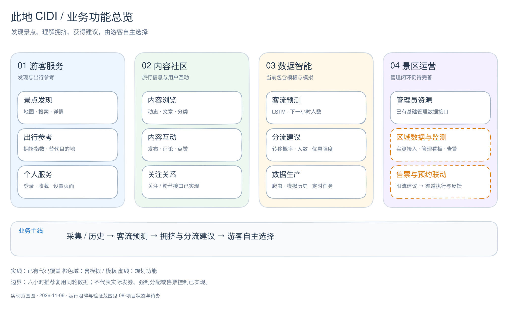
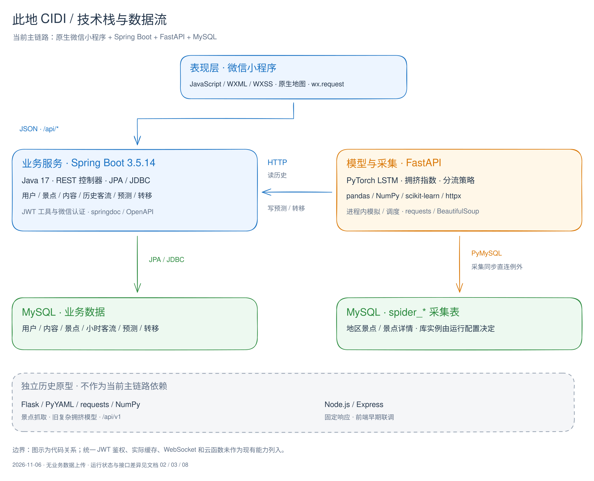

## 01 项目总览

> 基线：2026-11-06，本地代码 `9fb6112`。功能状态表示代码覆盖范围，运行阻碍见 [08 项目状态](./08-项目状态与待办.md)。

### 1.1 目标与边界

此地 CIDI 是面向旅游场景的多景区游客协调分流系统：展示景点与旅行内容，根据历史客流预测下一小时人数，并给出拥挤参考和替代目的地建议。

游客自主决定是否接受推荐。当前系统没有强制分配游客、实际发券、控制景区售票或预约通道的完整业务闭环。

### 1.2 业务功能划分

[编辑 Excalidraw 源图](./12-图示/01-业务功能总览.excalidraw) · [PNG 图片](./12-图示/01-业务功能总览.png)

| 业务域 | 现有能力 | 边界 |
| --- | --- | --- |
| 游客服务 | 景点列表、地图、搜索、详情、收藏、微信登录、设置页面 | 设置/反馈等页面不代表所有后台写入已接通；文件上传后端未找到 |
| 内容社区 | 动态、文章、分类、发布、评论、点赞；后端关注关系接口 | 部分列表由前端聚合；关注接口存在不代表页面已接入 |
| 数据智能 | LSTM 客流预测、拥挤指数、分流概率与预期人数、舒适景点查询 | 区域数据使用模板，历史不足会模拟；结果尚无正式效果评估 |
| 景区运营 | 管理员资源 CRUD | 管理看板、区域实测接入、告警、售票/预约控制属于后续规划 |

主包页面：欢迎、探索、动态、地图、分流/收藏、个人中心、搜索。分包页面：文章、地点、设置、反馈、登录、发布。

### 1.3 技术栈与服务分工

[编辑 Excalidraw 源图](./12-图示/02-技术栈与数据流.excalidraw) · [PNG 图片](./12-图示/02-技术栈与数据流.png)

| 模块 | 技术 | 职责 | 入口 |
| --- | --- | --- | --- |
| `devs/frontend/cidi-wx` | 原生微信小程序、JavaScript、WXML、WXSS | 游客界面、地图、HTTP 请求、预测展示 | `app.js`、`api/cidi.js` |
| `devs/backend/cidi-server` | Java 17、Spring Boot 3.5.14、JPA/JDBC、JWT、springdoc | 业务数据、微信认证、历史流量、预测与转移 API | `CidiApplication.java`、19 个控制器 |
| `devs/backend/cidi-model` | FastAPI、PyTorch、pandas、NumPy、scikit-learn、httpx、PyMySQL | LSTM、拥挤量化、分流策略、模拟、调度、采集 | `main.py` |
| MySQL | SQL 与 JPA 实体 | 用户、内容、景点、客流、预测及采集数据 | `devs/script/sql` |
| `cidi-mock` | Flask、PyYAML、requests、NumPy | 独立景点抓取和旧复杂模型原型 | `run.py`，默认 5000 |
| `nodejs临时返回数据` | Express | 早期固定响应原型 | `server.js` |

Java 依赖含 Redis/JDBC Session 与密码加密库，但尚不能据此认定缓存或统一鉴权已实现。当前仓库未见 MyBatis、WebSocket 业务或微信云函数；这些不再列为现有主链路。

### 1.4 核心数据流

1. 小程序通过 `api/http.js` 请求 Spring `/api/*`，Java 经 JPA 访问业务表。
2. FastAPI 经 Spring 获取景点和历史客流，训练预测下一小时人数，计算分流策略。
3. 模型经 Spring 批量写回 `spot_traffic_predictions` 与 `location_transitions`，小程序查询展示。
4. 爬虫同步直接访问 `spider_*` 表；这是业务数据经 Spring 访问规则的现存例外。
5. 模拟器与预测调度器需显式启用；详细行为见 [05 模型与预测](./05-模型与预测.md)。

“未来六小时目的地”目前是最新一轮 Top 3 数据按小时重复展示，不能解释为六步模型预测。图中的现有链路描述代码关系，不代表端到端验收通过。
