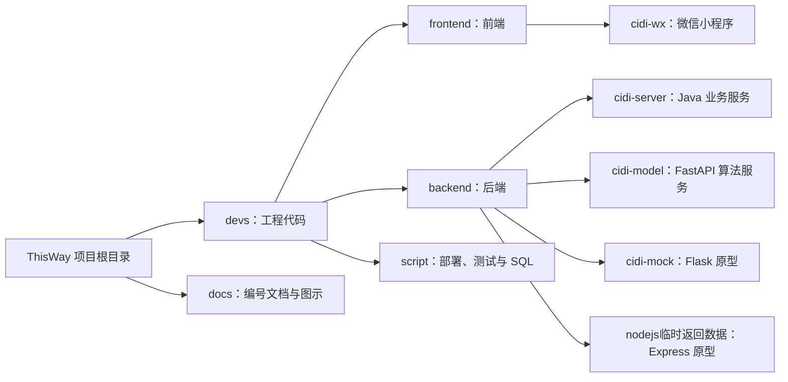

## 02 开发与运行

> 所有命令均标明执行目录。当前小程序存在未解决合并冲突，先查 [08 项目状态](./08-项目状态与待办.md)。

### 2.1 目录与启动顺序



本地主链路按 **隔离的 MySQL → Spring Boot → FastAPI → 小程序** 启动。基础表和可选表初始化见 [04 数据设计](./04-数据设计.md)。Flask/Express 不要求随主链路启动。

### 2.2 Java 业务服务

需要 JDK 17 和系统 Maven。仓库没有 Maven Wrapper，使用 `mvn`，不使用旧说明里的 `./mvnw`。

主配置：[application.properties](../backend/cidi-server/src/main/resources/application.properties)。仅有一份统一主配置，没有仓库内的 dev/uat/prod 三套配置文件。

| 环境变量 | 默认值/要求 | 用途 |
| --- | --- | --- |
| `SPRING_DATASOURCE_URL` | `jdbc:mysql://localhost:3306/cidi-db?useSSL=false&serverTimezone=UTC` | JDBC 地址，本机开发默认值 |
| `SPRING_DATASOURCE_USERNAME` | `root` | 数据库账号 |
| `SDP` | 主文件密码占位符，无默认值 | 数据库密码；启动脚本对此变量有必填检查 |
| `WX_APPID`、`WX_SECRET` | 空 | 真实微信认证凭证 |
| `WX_MOCK_LOGIN_ENABLED` | `false` | 本地测试可显式启用模拟登录 |
| `WX_MINI_PROGRAM_ENV` | `dev` | 微信环境标识 |
| `JWT_SECRET` | 空 | JWT 密钥，当前使用 HS512，应提供至少 64 字节 |
| `JWT_EXPIRATION` | `604800000` 毫秒 | Token 有效期 |
| `WX_PHONE_API_URL` | 配置内微信手机号地址 | 微信接口覆盖项 |

Spring 的标准环境变量 `SPRING_DATASOURCE_PASSWORD` 可以覆盖 `spring.datasource.password`，但现有启动脚本有的只检查 `SDP`。本说明统一使用 `SDP`，避免脚本检查与属性覆盖规则混淆。`WX_APPID_PROD`、`JWT_SECRET_DEV` 等自定义后缀没有当前映射。

在单独终端配置本地测试环境；密码从输入读取，不写入仓库：

```bash
cd devs/backend/cidi-server
export SPRING_DATASOURCE_URL='jdbc:mysql://127.0.0.1:3306/cidi-db?useSSL=false&serverTimezone=UTC'
export SPRING_DATASOURCE_USERNAME='cidi_dev'
read -r -s -p '数据库密码: ' SDP
export SDP
export WX_MOCK_LOGIN_ENABLED=true
export JWT_SECRET="$(openssl rand -hex 64)"
mvn -DskipTests package
java -jar target/cidi-0.0.1-SNAPSHOT.jar
```

默认端口 8080；接口文档 `/doc.html`，OpenAPI `/v3/api-docs`。`-DskipTests` 仅跳过测试，不是测试通过。不要直接运行当前 Java 集成测试：它显式加载含远程 MySQL 地址和 `ddl-auto=update` 的测试配置，应先隔离。

### 2.3 FastAPI 算法服务

选择能安装 [requirements.txt](../backend/cidi-model/requirements.txt) 的 Python 环境；当前依赖只有最低版本约束，没有锁文件和完整兼容矩阵。

```bash
cd devs/backend/cidi-model
python3 -m venv .venv
source .venv/bin/activate
python -m pip install -r requirements.txt
export SPRING_BASE_URL='http://127.0.0.1:8080'
export SCENIC_SEED=42
export HISTORY_HOURS=168
uvicorn main:app --host 127.0.0.1 --port 8001
```

开发热重载可加 `--reload`；正式运行不要使用热重载。默认任务在进程内，启用调度时先保持单 worker，避免重复生产数据。

| 配置 | 默认值 | 范围 |
| --- | --- | --- |
| `SPRING_BASE_URL` | `http://localhost:8080` | 业务数据 API |
| `SCENIC_SEED` | 42 | 随机种子 |
| `HISTORY_HOURS` | 168 | 历史窗口小时数 |
| `MYSQL_HOST/PORT/USER/PASSWORD/DATABASE` | `127.0.0.1/3306/root/空/cidi_db` | 仅采集同步所需的直连配置 |
| `MYSQL_TABLE_SPIDER_SPOTS` | `spider_regional_scenic_spots` | 地区景点表 |
| `MYSQL_TABLE_SPIDER_SPOT_DETAILS` | `spider_scenic_spot_details` | 详情表 |
| `SPOT_DETAIL_SYNC_DELAY_SECONDS` | 1.5 | 抓取间隔 |
| `SPOT_DETAIL_SYNC_JITTER_SECONDS` | 0.8 | 间隔抖动 |

访问 `http://127.0.0.1:8001/docs` 查看路由。爬虫默认库名 `cidi_db` 与 Java 的 `cidi-db` 不同，运行前显式选择，不能假设共用。

### 2.4 微信小程序

微信开发者工具导入 `devs/frontend/cidi-wx`，使用该目录的 `project.config.json`。根目录及 `devs/frontend` 的同名配置不是这里推荐的导入入口。

- 主入口：`app.js`；页面注册：`app.json`；网络封装：`api/http.js`；业务适配：`api/cidi.js`。
- `globalData.apiBaseUrl` 决定 Java 地址，本地缓存的 `apiBaseUrl` 会覆盖初始值；设置页可修改。
- 开发者工具访问本机服务可用 `127.0.0.1`；真机应使用开发机局域网地址。正式发布需配置实际 HTTPS 服务域名。
- `uploadApiPath` 指向 `/api/files/upload`，当前未找到 Java 上传控制器；不要将上传失败归为前端地址问题后直接宣布联调完成。
- 当前 `app.js` 两个冲突分支的默认地址不同，解决冲突前无法给出唯一有效默认值。

### 2.5 独立原型

Flask：在 `devs/backend/cidi-mock` 安装其依赖，并补装旧算法实际需要的 NumPy，再执行 `python run.py`。默认 `127.0.0.1:5000`、debug 开启，适用于原型开发；API 前缀 `/api/v1`。Express：在 `devs/backend/nodejs临时返回数据` 执行 `npm ci`，随后按 `package.json` 的脚本或 `node server.js` 启动。两者均未作为当前主业务后端。
